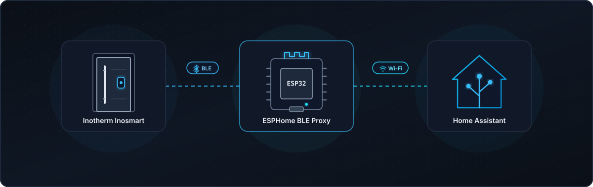

# Schritt-für-Schritt-Anleitung für Einsteiger

Du hast noch nie etwas mit **ESP32**, **ESPHome** oder **Home Assistant** gemacht? Kein Problem! Diese Anleitung erklärt dir alles von Grund auf — ohne Fachchinesisch.

---

## Was machen wir hier überhaupt?

Deine **Inotherm-Haustür** hat eingebautes **Bluetooth** (genau wie kabellose Kopfhörer). Normalerweise redet sie darüber nur mit der offiziellen Handy-App, wenn du direkt vor der Tür stehst.

Damit du die Tür auch über **Home Assistant** (deine Smart-Home-Zentrale) öffnen kannst, bauen wir uns eine kleine **Funk-Brücke**:

```text
Haustür  <── Bluetooth (kurze Reichweite) ──>  ESP32-Stecker im Flur  <── WLAN ──>  Home Assistant
```

**Warum braucht man diesen ESP32 dazwischen?**
1. **Reichweite:** Bluetooth reicht nur ein paar Meter. Dein Home-Assistant-Server steht meistens irgendwo im Keller oder Technikraum — viel zu weit weg von der Haustür.
2. **Der kleine Trick:** Die Inosmart-Tür ist beim Bluetooth-Verbinden etwas eigenwillig. Auf dem kleinen ESP32 läuft eine angepasste Software aus diesem Projekt, damit die Tür ihm vertraut und ihn nicht sofort wieder rauswirft.

---

## Was du dafür brauchst

- [ ] Eine **Inotherm-Haustür** mit Inosmart (z. B. BT 640) + deinen **Admin-Finger** (der Finger, mit dem du an der Tür neue Nutzer anlernen darfst).
- [ ] Einen **ESP32** (ein kleiner Mikrocontroller-Chip auf einer Platine, kostet ca. 5–10 €, z. B. „ESP32 DevKit“).
- [ ] Ein **USB-Kabel** vom PC zum ESP32 *(wichtig: es muss ein **Datenkabel** sein — manche ganz billigen Ladekabel können nur Strom übertragen, keine Daten!)*.
- [ ] Ein **normales Handy-Netzteil** (USB-Stecker für die Steckdose) im Flur in der Nähe der Haustür.
- [ ] Den Namen und das Passwort deines **2,4-GHz-WLANs** *(ESP32-Chips können kein 5-GHz-WLAN, die meisten Router funken aber automatisch auf beiden)*.
- [ ] Ein laufendes **Home Assistant** (idealerweise mit installiertem **HACS** – das ist so etwas wie der „App Store“ für Zusatz-Erweiterungen in Home Assistant).

---

## Schritt 1: Den ESP32 programmieren (die Funk-Brücke bauen)

Jetzt bringen wir dem kleinen ESP32 bei, wie er sich mit deinem WLAN verbindet und mit der Tür spricht.

1. **Projekt herunterladen:**
   Lade dir dieses Projekt auf deinen Computer herunter (auf GitHub oben auf **Code → Download ZIP** klicken und entpacken, oder per `git clone`).

2. **WLAN-Daten eintragen:**
   Im Ordner `esphome/` liegt eine Datei namens `secrets.yaml.example`.
   - Kopiere diese Datei und benenne die Kopie in **`secrets.yaml`** um (ohne `.example` am Ende).
   - Öffne `esphome/secrets.yaml` mit einem Texteditor und trage dort deinen WLAN-Namen und dein WLAN-Passwort ein:
     ```yaml
     wifi_ssid: "DeinWLANName"
     wifi_password: "DeinWLANPasswort"
     ```
   - Speichern! *(Keine Sorge: Diese Datei bleibt privat auf deinem PC und wird nicht hochgeladen.)*

3. **ESPHome auf dem PC installieren (falls noch nicht vorhanden):**
   Öffne ein Terminal (Eingabeaufforderung) im heruntergeladenen Projektordner und installiere ESPHome:
   ```bash
   pip install esphome
   ```

4. **ESP32 per USB anschließen und bespielen:**
   - Stecke den ESP32 mit dem USB-Datenkabel an deinen Computer.
   - Starte diesen Befehl im Terminal:
     ```bash
     esphome run esphome/inosmart-bluetooth-proxy.yaml
     ```
   - Falls er fragt, worüber er flashen soll, wähle den **USB-Anschluss** (z. B. `/dev/ttyUSB0` oder `COM3`) aus.
   - Jetzt dauert es beim ersten Mal 1–3 Minuten, bis alles übersetzt und auf den Chip geladen ist. Wenn am Ende grüne/weiße Log-Zeilen durchlaufen und da steht, dass er mit dem WLAN verbunden ist, hat es geklappt! *(Mit `Strg + C` kannst du die Anzeige beenden.)*

5. **Ab in den Flur:**
   Ziehe den ESP32 vom PC ab und stecke ihn mit dem Handy-Netzteil in eine Steckdose **möglichst nah an der Haustür**.

---

## Schritt 2: Den ESP32 in Home Assistant aufnehmen

1. Öffne **Home Assistant** im Browser oder in der App.
2. Gehe links unten auf **Einstellungen → Geräte & Dienste**.
3. Home Assistant sollte den neuen **„Haustür Bluetooth Proxy“** schon automatisch gefunden haben. Klicke auf **Konfigurieren → Absenden**.
4. **Wichtiger Tipp:** Klicke beim neuen ESPHome-Gerät auf **Konfigurieren** (Zahnrad / Optionen) und stelle sicher, dass beim Bluetooth-Scanmodus **`active`** ausgewählt ist. Nur dann hört der ESP32 den Namen der Tür (`iN00...`) zuverlässig.

---

## Schritt 3: Die Tür-Erweiterung in Home Assistant installieren

Jetzt braucht Home Assistant noch das „Wörterbuch“, um die Nachrichten der Tür zu verstehen.

### Am einfachsten über HACS:
1. Öffne in Home Assistant links **HACS → Integrationen**.
2. Klicke oben rechts auf die **drei Punkte (⋮) → Benutzerdefinierte Repositories**.
3. Füge die Internetadresse (URL) dieses GitHub-Projekts ein und wähle als Kategorie **Integration** → **Hinzufügen**.
4. Suche in HACS nach **Inotherm Inosmart BLE** und klicke auf **Herunterladen**.
5. **Starte Home Assistant einmal komplett neu** (*Einstellungen → System → Neu starten*).

*(Falls du kein HACS nutzt: Kopiere den Ordner `custom_components/inosmart` aus diesem Projekt direkt in den `custom_components`-Ordner deines Home Assistant und starte neu.)*

---

## Schritt 4: Tür und Home Assistant einmalig bekannt machen (Koppeln)

Genau wie du ein neues Handy einmal an der Tür anmelden musst, meldest du jetzt Home Assistant einmalig an der Tür an.

1. **An der Haustür:**
   - Öffne die kleine Abdeckung / Steuereinheit im Türflügel.
   - Halte **Taste 1** etwa **2 Sekunden** gedrückt und lege außen sofort deinen **Admin-Finger** auf den Scanner.
   - Wenn **beide LEDs am Scanner weiß leuchten**, wartet die Tür auf ein neues Gerät!

2. **In Home Assistant:**
   - Gehe wieder zu **Einstellungen → Geräte & Dienste**.
   - Entweder wird die Inosmart-Tür schon automatisch als „Entdeckt“ angezeigt (dann auf **Konfigurieren** klicken), oder du klickst unten rechts auf **+ Integration hinzufügen** und suchst nach **Inotherm Inosmart BLE**.
   - Im Fenster steht schon eine 15-stellige Nummer (**Client-IMEI**) — das ist sozusagen die „Ausweisnummer“ deines Home Assistant für die Tür.
   - Lass den Schalter **„Sofort über BLE koppeln“** eingeschaltet und klicke auf **Absenden**.

**Geschafft!** Nach wenigen Sekunden ist die Tür verbunden und du siehst in Home Assistant dein neues Türschloss und mehrere Schalter.

---

## Was bedeuten die ganzen Knöpfe?

- **Schloss (`lock`) / „Tür öffnen“:** Öffnet die Haustür (zieht die Falle zurück). Nach 3 Sekunden springt die Anzeige wieder auf „Verriegelt“ — das ist normal, damit man sieht, dass der Öffnungs-Impuls wieder vorbei ist.
- **Tag-Entriegelung (`Ready2Open`):** Schaltet die Tür vorübergehend so, dass man sie von außen einfach aufdrücken kann (z. B. praktisch beim Einkäufe-Reintragen).
- **Relais 2:** Ein zweiter Schaltkontakt in der Türsteuerung (wird z. B. oft für ein Garagentor oder ein Hoftor genutzt, falls angeschlossen).
- **LED-Regler (`HLED` / `SLED`):** Damit lässt sich die Helligkeit der Türbeleuchtung einstellen. *(Achtung: Dafür muss man zusätzlich das Admin-Passwort eintragen und an der Tür Taste 3 für den Admin-Modus drücken — zum reinen Türöffnen brauchst du das **nicht**.)*

---

## Wenn etwas nicht klappt (Checkliste)

1. **Die Tür reagiert in Home Assistant plötzlich nicht mehr:**
   Die Inosmart-Tür kann immer nur mit **einem Gerät gleichzeitig** über Bluetooth sprechen. Wenn du auf deinem Handy gerade die offizielle **InoSmart-App** offen hast, blockiert die App die Verbindung. Schließe die App komplett, dann klappt es nach ein paar Sekunden wieder.
2. **Schlechter Empfang:**
   Wenn Home Assistant Verbindungsfehler meldet, steckt der ESP32 wahrscheinlich zu weit weg oder hinter zu viel Metall/Beton. Ideal ist eine Steckdose im Flur direkt neben der Tür.
3. **ESP32 wird beim Anschließen am PC nicht erkannt:**
   Fast immer liegt es am USB-Kabel (reines Ladekabel ohne Datenleitungen). Probiere ein anderes USB-Kabel!
